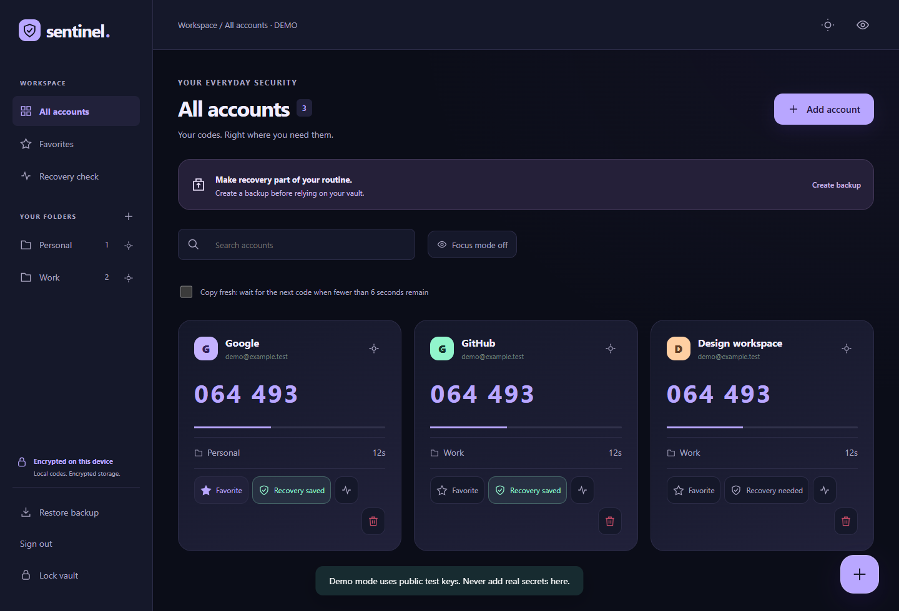
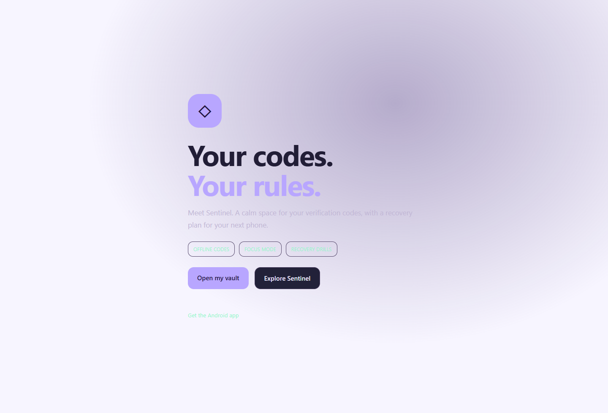
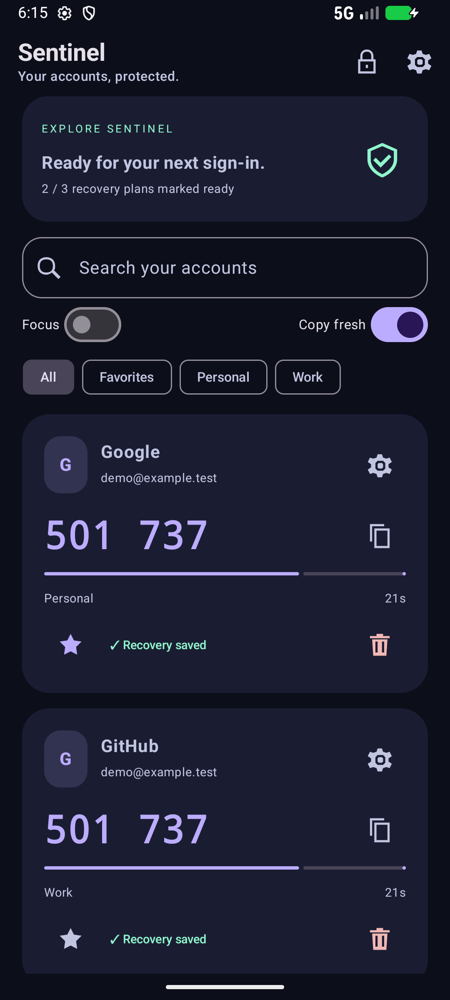
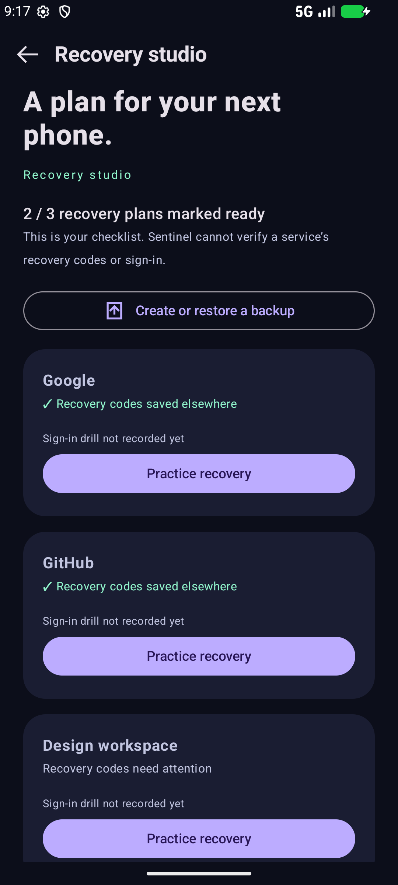
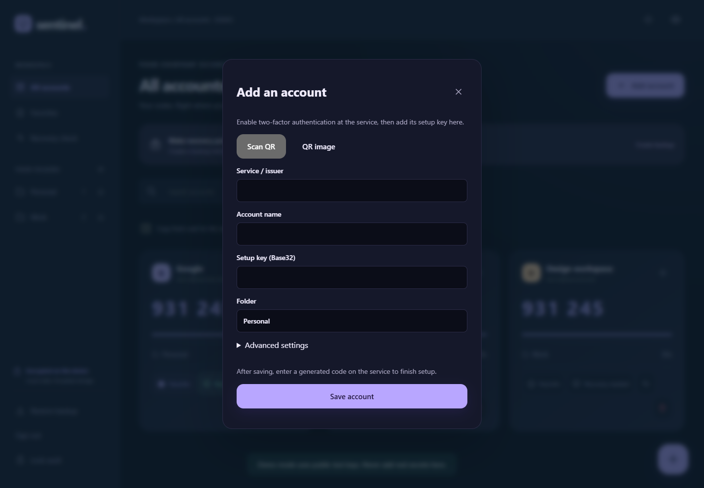
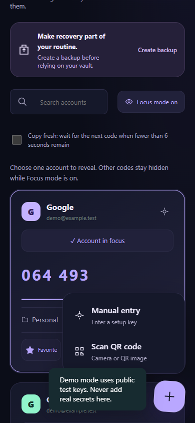
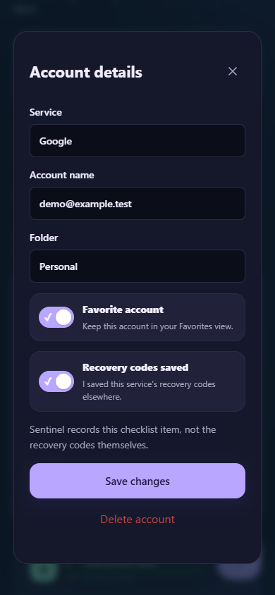
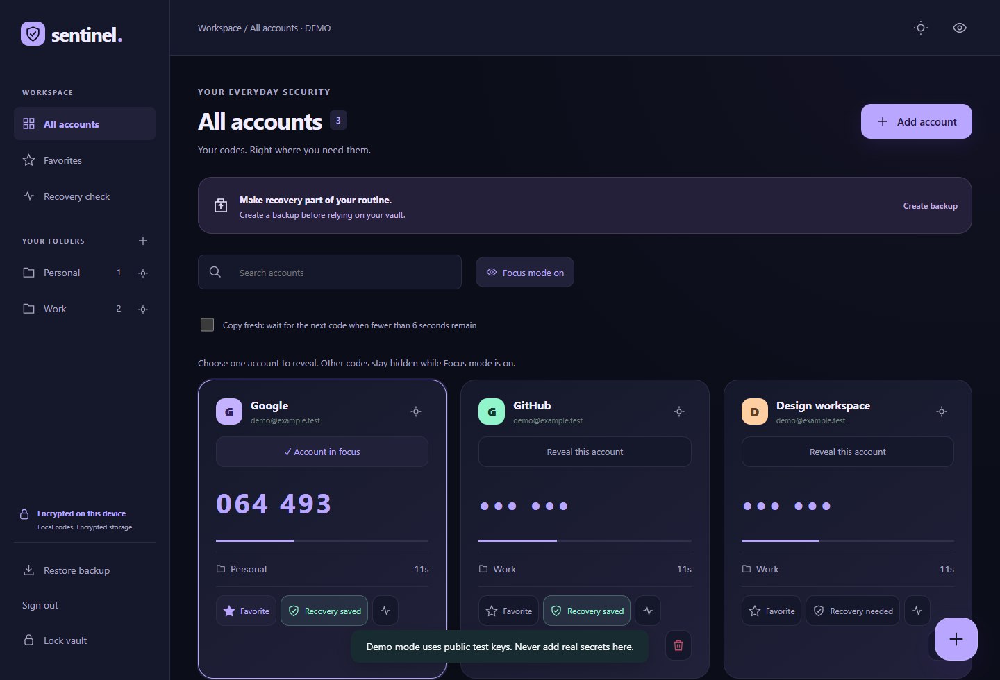
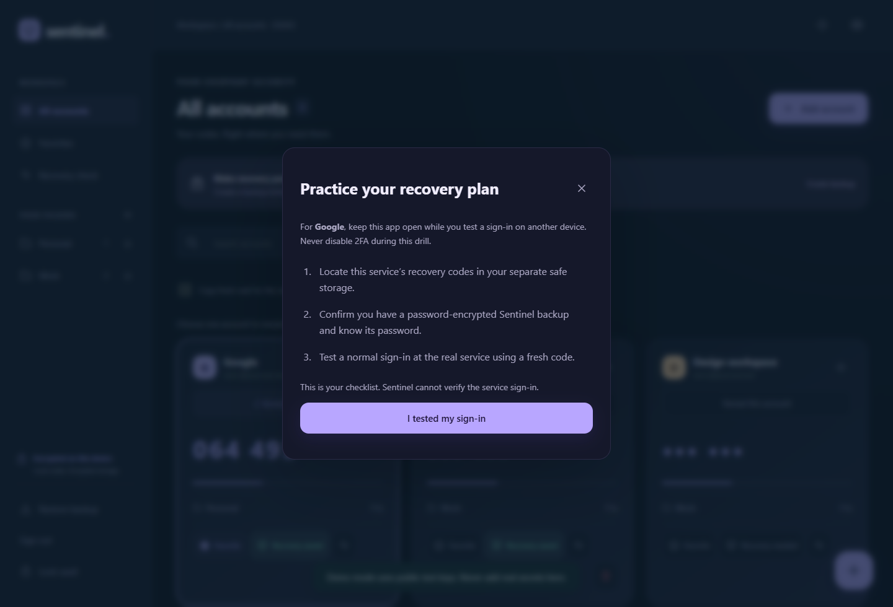

# Sentinel Authenticator

**Your codes. Your rules.** A native Android authenticator and a responsive web vault, built around local control and practical recovery.

[Download Android 0.4.0 beta](https://github.com/codexanjan/sentinelai/releases/tag/v0.4.0) · [Open web app](https://sentinel-authenticator.vercel.app) · [Release notes](docs/RELEASE_0.4.0.md)

**Start here:** [How it works](#how-it-works) · [Photo walkthrough](#photo-walkthrough) · [Install Android](#install-the-apk) · [Try the demo](#demo)



## What you can do

| Feature | Android | Web |
| --- | --- | --- |
| Offline TOTP, SHA1/256/512, 6/8 digits | Yes | Yes, after required assets are cached |
| Manual setup key and QR enrollment | Camera + manual | Camera, QR image + manual |
| Focus mode: reveal one account at a time | Yes | Yes |
| Copy fresh: wait at the end of a code period | On by default | Optional switch |
| Clock-change warning during an open session | Yes | Yes |
| Recovery studio / guided sign-in drill | Yes | Yes |
| Favorite accounts and folder filtering | Yes | Yes |
| Create/rename/remove empty folders | Folder names are edited per account | Yes |
| Device credential / strong biometric unlock | Yes | Separate vault password |
| Password-encrypted portable backup | Yes | Yes |
| Public demo using RFC test keys | Read-only, clears on background | Isolated in memory |

Recovery drills are self-recorded checklists. They do not verify a service login or recovery codes. Focus mode controls what is displayed; it is not an additional encryption boundary. Clipboard access can be denied by the browser, in which case you can read the displayed code.

## How it works

| Step | What you do | What happens |
| --- | --- | --- |
| 1. Open your vault | On Android, choose **Open local vault** and unlock with your device credentials. On web, choose **Open your vault** and create or enter its password. | Your local vault opens. An account login is not required. |
| 2. Enable 2FA at the service | Open the security settings of the account you want to protect and choose an authenticator app. | The service provides a QR code or a setup key. Sentinel cannot enable 2FA for you. |
| 3. Add the account | Tap **+**, then **Scan QR code** or **Manual entry**. Review the service and account details before saving. | Sentinel stores the setup key inside your encrypted local vault. Web also accepts a QR image. |
| 4. Confirm setup | Enter the current Sentinel code on the service's setup page. | The service confirms that your authenticator is connected. |
| 5. Sign in next time | Enter your password at the service, then read or copy its current Sentinel code. | Sentinel generates the code locally from the setup key and device time. A typical account refreshes every 30 seconds. |
| 6. Prepare for recovery | Save the service's recovery codes separately, create an encrypted Sentinel backup and test restoring it on a trusted device. | You have a recovery path before you lose or replace your phone. Keep the backup password safe. |

**Everyday controls:** use folders and favorites to find accounts; turn on **Focus mode** to reveal one code at a time; use **Copy fresh** to wait for the next period when a code is about to expire. Recovery studio provides a checklist for practicing a normal service sign-in.

Codes work without a connection once their setup keys are on the device. The website needs its offline assets cached first. Keep automatic date and time enabled: Sentinel and the service must agree on the time. Account login does not sync or decrypt your vault.

Want to explore before enrolling an account? Choose **Try demo**. Use only the public demo accounts there; add personal accounts in your own local vault.

## Faster first screen

The old waiting card has been replaced with an immediate, lightweight intro. QR, account SDK and Argon2 libraries are loaded only when their features are needed. The demo uses an ephemeral random encryption key, without deriving a password key. Real vaults and backups retain Argon2id (64 MiB, three iterations) and AES-GCM; encryption was not weakened to speed up startup. Android initializes device storage away from the UI thread and shows its intro immediately.

## Install the APK

1. Download `SentinelAuthenticator-0.4.0.apk` and its SHA256 file from Releases.
2. Use Android 11 or newer. Allow your browser/file manager to install this APK when prompted.
3. Keep the existing app installed when upgrading so local data remains in place. This release uses the same package and signing key as previous Sentinel builds.
4. Choose **Open my vault**. Set a secure device PIN/password if requested, then unlock. Or choose **Try demo** without adding real secrets.
5. Enable 2FA in each service, add its QR/setup key, and confirm a generated code at that service.

Make and test a password-encrypted backup before upgrades or changing phones. Account organization is now stored in Android local payload v2, with v1 read compatibility. Downgrading to 0.3.0 cannot read that enriched local vault; the portable v1 backup remains compatible and omits folders, favorites and drill history.

## Demo

Web demo: `demo@sentinel.example` / `SentinelDemo123!`, or use **Try demo**. Android has a direct read-only demo. All displayed demo keys are public RFC test material. Android screenshots are allowed in this public demo; real vault screens keep screenshot protection and immediate background locking.

## Photo walkthrough

These are actual Android and web screenshots using public demo accounts. The landing page contains an illustrative account preview. No personal setup keys appear in these images. Click an image to view it at full size.

### 1. Meet Sentinel

The landing page introduces local codes and encrypted recovery. Open a vault, explore the demo or download the Android APK.



### 2. Your Android workspace

The native vault shows live codes, folder filters, favorites and recovery status. Recovery studio helps you plan for a new phone and practice your sign-in workflow.

<a href="docs/screenshots/android-demo.png"></a> <a href="docs/screenshots/android-recovery.png"></a>

### 3. Add and organize an account

The bottom-right **+** opens manual-entry and QR options. Manual entry accepts the service name, account name, Base32 setup key and folder. Advanced settings support compatible algorithm, digit and period choices; use the values supplied by the service.



The mobile web menu keeps enrollment within reach. Account details use switches for favorites and your saved-recovery-code checklist; the checklist stores your confirmation, not the recovery codes.

<a href="docs/screenshots/web-add-mobile.png"></a> <a href="docs/screenshots/web-switches-mobile.png"></a>

### 4. Reveal one code with Focus mode

Choose an account to reveal its code while other codes stay hidden. Hidden account codes cannot be copied until revealed.



### 5. Practice your recovery plan

Locate the service's recovery codes, check your encrypted backup and test a normal sign-in at the real service. Record the completed drill in your vault. Sentinel does not verify that external sign-in.



[Browse all screenshots](docs/screenshots) · [Download release screenshots](https://github.com/codexanjan/sentinelai/releases/download/v0.4.0/SentinelAuthenticator-0.4.0-screenshots.zip) (original eight release images; this README also includes the newer manual-entry photo)

## Build from source

`android/` contains Kotlin, Jetpack Compose, CameraX/ZXing and the Gradle wrapper. Install Android SDK 35 and JDK 17 or newer, then:

```sh
cd android
./gradlew testDebugUnitTest lintRelease assembleDebug
```

Windows: use `gradlew.bat`. Debug APKs use a different key from the published beta. For a signed release, supply `SENTINEL_KEYSTORE`, `SENTINEL_STORE_PASSWORD` and `SENTINEL_KEY_PASSWORD`; key alias is `sentinel`. Signing material is not committed. APK code and resources are shrunk in release builds.

The web app has no build step:

```sh
python -m http.server 4186 --directory web/dist
```

Use localhost or HTTPS. The existing Vercel deployment serves `web/dist` as static files. Release APKs are stored on GitHub Releases; a copy is also made available through the live website.

## Authentication and privacy

Local vaults require no account. Email/Google/Apple integration and screens are present, but real login is **not enabled** until a backend and provider credentials are configured. There is no cloud sync in this edition. See [authentication setup](docs/AUTH_SETUP.md) and [security model](docs/SECURITY_MODEL.md).

No ads, analytics or AI processing of OTP secrets. `INTERNET` is used for optional account login; codes are generated locally. Never commit service-role keys, OAuth secrets, vaults or real QR/setup keys.

## Status and validation

This is a **beta**, signed with the existing local development release key. Core correctness and browser workflows are tested; comprehensive physical-device, accessibility and independent security review are still pending. Exact results and limits are in [validation](docs/VALIDATION_0.4.0.md).

The product documents in `docs/01_*` through `docs/07_*` are the original plans, not a statement that every planned feature is implemented. Current implemented behavior is described here and in the release notes.

## Feature research

Folders, pinning, offline codes and backups exist in other authenticators. This release adds a recovery-drill workflow and fresh-copy/Focus controls to Sentinel; it does not claim market-wide exclusivity. See [feature comparison sources](docs/FEATURE_RESEARCH.md).

## License

Original Sentinel source is MIT licensed. Vendored libraries and the Gradle wrapper retain their own license notices.
